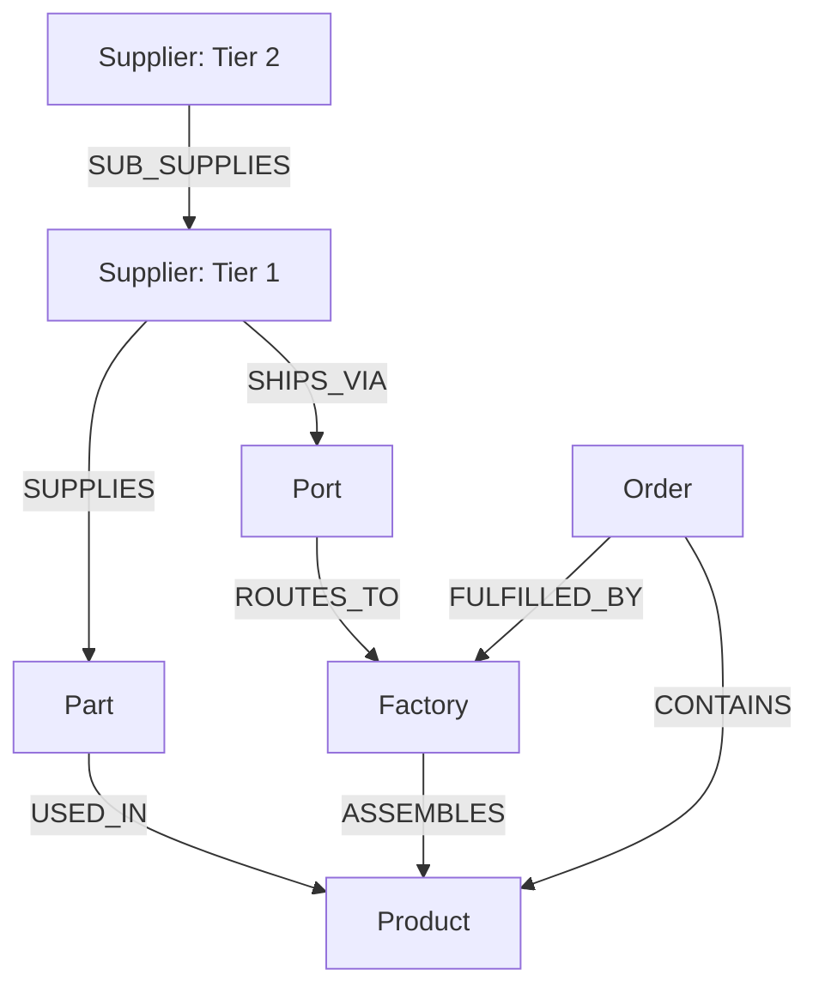

# SupplyShock ⚡

**AI-powered supply-chain disruption mitigation.**  
An agent that turns a supply-chain disruption into a verified, human-approved mitigation — fully powered by FalkorDB graph traversal and algorithms.

---

## Hackathon Submission Details

- **Track Entered**: **Agents That Act on Connected Data** (Primary) & **Company Brain** (Secondary)
- **Primary Database**: **FalkorDB** (GraphBLAS-powered graph engine)
- **Repository**: [https://github.com/shakthikalyan/Supply-Shock](https://github.com/shakthikalyan/Supply-Shock)
- **Demo Video**: *(Link to your demo video)*
- **AI Tool Disclosure**: Developed with the assistance of Antigravity AI coding assistant.

---

## Graph Data Model

SupplyShock models an interconnected global supply network. The graph schema consists of 6 primary node labels and 8 relationship types:



### Node Labels & Schema
| Node Label | Key Properties | Purpose |
|---|---|---|
| `Supplier` | `id`, `name`, `country`, `tier`, `reliability`, `status` | Tier-1 and Tier-2 component suppliers |
| `Port` | `id`, `name`, `country`, `status` | Maritime logistics choke points |
| `Factory` | `id`, `name`, `region` | Assembly and manufacturing facilities |
| `Part` | `sku`, `name`, `category`, `lead_time_days` | Critical and standard bill-of-materials components |
| `Product` | `sku`, `name` | Finished products sold to commercial buyers |
| `Order` | `id`, `customer`, `value`, `due_date`, `priority`, `status` | Customer orders with financial value and delivery SLA |

### Relationship Types
| Relationship | Between | Properties | Description |
|---|---|---|---|
| `SUB_SUPPLIES` | `Supplier → Supplier` | — | Upstream tier-2 dependency on tier-1 suppliers |
| `SHIPS_VIA` | `Supplier → Port` | `transit_days`, `status` | Maritime shipping path for parts |
| `ROUTES_TO` | `Port → Factory` | `transit_days`, `cost`, `capacity` | Overland routing throughput to assembly plant |
| `SUPPLIES` | `Supplier → Part` | `cost`, `lead_time_days`, `share`, `capacity` | Component manufacturing contract |
| `USED_IN` | `Part → Product` | `qty` | Bill-of-materials specification |
| `ASSEMBLES` | `Factory → Product` | — | Plant assembly capability |
| `CONTAINS` | `Order → Product` | — | Finished product requested in order |
| `FULFILLED_BY` | `Order → Factory` | — | Target plant responsible for order completion |

---

## Rule 3 (Kill-Switch & Real Work)

**Without FalkorDB there is no answer, not a degraded one.**  
If the database is unreachable, the agent returns:
```json
{"error": "FalkorDB unavailable — cannot analyse disruption without the graph."}
```
No hallucinated numbers. No partial results. The API returns HTTP 503 for all write operations. All numbers, paths, and mitigation decisions are derived from live Cypher graph traversals and GraphBLAS algorithm executions.

---

## FalkorDB Algorithms & MCP Tool Catalogue

All tools are registered on the MCP server (`app/mcp_server.py`). The agent calls them by name; the registry dispatches to the underlying Cypher-backed Python functions.

### Analysis tools (read-only)

| Tool | Technique | Cypher file |
|---|---|---|
| `get_blast_radius(node_id)` | Multi-hop traversal (up to 6 hops) | `queries/get_blast_radius.cypher` |
| `find_at_risk_orders(node_id)` | Traversal + alternate-source check | `queries/find_at_risk_orders.cypher` |
| `rank_critical_suppliers()` | PageRank (`algo.pageRank`) | `queries/rank_critical_suppliers.cypher` |
| `find_choke_points()` | Betweenness centrality (`algo.betweenness`) | `queries/find_choke_points.cypher` |
| `find_dependency_clusters()` | WCC (`algo.wcc`) | `queries/find_dependency_clusters.cypher` |
| `find_alternate_sources(part, avoid)` | Weighted path, excluding failed node | `queries/find_alternate_sources.cypher` |
| `check_reroute_capacity(factory, qty)` | Dynamic bottleneck path capacity | `queries/check_reroute_capacity.cypher` |

### Simulation tool

| Tool | Purpose |
|---|---|
| `simulate_mitigation(change_set)` | `GRAPH.COPY` → mutate copy → re-run impact → diff → delete copy |

### Action tools (all gated — nothing executes without human approval)

| Tool | Purpose |
|---|---|
| `draft_purchase_order(supplier, part, qty)` | Writes a draft to the outbox |
| `notify_owner(owner, message, evidence_path)` | Drafts a notification with traversal evidence |
| `commit_mitigation(proposal_id)` | POST `/api/proposals/{id}/approve` — mutates live graph |

---

## Architecture

```
 Event (webhook / UI button)
        │
        ▼
 FastAPI backend (app/main.py)
        │
        ├── Event Ingestor  →  marks node as 'disrupted' in FalkorDB
        │
        ├── Agent Orchestrator (app/agent.py)
        │     └── Google Gemini / Local Zero-Cost Graph Agent • tool-calling loop
        │
        ├── MCP Server (app/mcp_server.py)  ←  named tools, JSON schemas
        │     ├── Analysis  (app/tools/analysis.py)
        │     ├── Simulation (app/tools/simulate.py)   ← GRAPH.COPY
        │     └── Actions   (app/tools/actions.py)     ← outbox + approval gate
        │
        ├── FalkorDB (graph + GraphBLAS algorithms)
        │     └── queries/*.cypher  (one file per tool, parameterised only)
        │
        ├── Audit Log (app/audit.py)  →  JSONL on disk + SSE stream
        │
        └── Web UI (web/index.html)
              ├── Cytoscape.js graph canvas
              ├── Live Cypher log (SSE)
              ├── Agent reasoning panel (SSE)
              └── Proposal card + Approve / Reject
```

---

## Planted Surprise (the demo story)

```
SUP-T2-01 (CapTech Asia, tier-2)
    └── SUB_SUPPLIES ──► SUP-01 (ElecCore)   ──► 4 capacitor parts
    └── SUB_SUPPLIES ──► SUP-02 (ChipNation) ──► 5 MCU / wireless parts
    └── SUB_SUPPLIES ──► SUP-03 (PowerFlex)  ──► 3 power module parts
                         All three SHIPS_VIA PORT-01 (Shanghai) ONLY
                                    │
                         PORT-01 closes ◄── THE EVENT
                                    │
                         14 HIGH-priority orders ← fully blocked
                         (no healthy alternate source path exists)
```

The three tier-1 suppliers look independent. They are not.  
`find_dependency_clusters()` (WCC) reveals they all live in the same connected component.  
`find_choke_points()` (betweenness centrality) identifies PORT-01 as the critical bottleneck.

---

## Quick Start (100% Free / No Paid Subscriptions)

### Prerequisites
- Docker & Docker Compose
- Python 3.11+
- *(Optional)* Free Google Gemini API Key from [Google AI Studio](https://aistudio.google.com/app/apikey) (or run with 0 keys in offline local agent mode).

### 1. Clone and configure

```bash
git clone https://github.com/shakthikalyan/Supply-Shock.git
cd Supply-Shock
cp .env.example .env
```

### 2. Start FalkorDB

```bash
docker compose up falkordb -d
# Verify container is running: docker compose ps
```

### 3. Seed the graph (Deterministic synthetic data)

```bash
pip install -r requirements.txt
python seed/generate.py --wipe
# Output: "300 orders (14 HIGH-priority at-risk)"
```

### 4. Run tests

```bash
python -m pytest tests/test_scenario.py -v
# 13 passed in <1s
```

### 5. Start the web dashboard

```bash
uvicorn app.main:app --reload
# Open http://localhost:8000
```

---

## Demo Script (3 minutes)

1. Open `http://localhost:8000` — explore the Cytoscape supply chain graph.
2. Click **Simulate Port Closure** — `PORT-01` turns red; the blast radius illuminates downstream supply links.
3. Watch the Cypher log stream queries in real time via Server-Sent Events (SSE).
4. The reasoning panel narrates each algorithm step (blast radius → at-risk orders → choke points → WCC clusters → simulation).
5. Mitigation Proposal appears: **14 orders at risk → 0 after reroute**.
6. Click **Approve & Commit** — state is locked, outbox releases the purchase order.
7. **Kill-switch demo:** Run `docker compose stop falkordb` and click simulate again → system refuses to hallucinate and enforces HTTP 503.

---

## Repo Structure

```
Supply-Shock/
├── docker-compose.yml          FalkorDB latest + app container
├── Dockerfile
├── requirements.txt
├── queries/                    One .cypher file per tool (parameterised only)
│   ├── get_blast_radius.cypher
│   ├── find_at_risk_orders.cypher
│   ├── rank_critical_suppliers.cypher
│   ├── find_choke_points.cypher
│   ├── find_dependency_clusters.cypher
│   ├── find_alternate_sources.cypher
│   └── check_reroute_capacity.cypher
├── seed/generate.py            Deterministic, seeded synthetic RNG (SEED=42)
├── app/
│   ├── main.py                 FastAPI + SSE endpoints
│   ├── graph.py                FalkorDB client, read/write guards
│   ├── audit.py                Audit log (JSONL + SSE pub/sub)
│   ├── agent.py                Gemini + Local Zero-Cost Graph Agent loop
│   ├── mcp_server.py           Tool registry + dispatcher
│   └── tools/
│       ├── analysis.py         Analysis tools (read-only)
│       ├── simulate.py         GRAPH.COPY simulation engine
│       └── actions.py          Outbox + approval gate
├── web/index.html              Cytoscape.js interactive UI
└── tests/test_scenario.py      Planted scenario + kill-switch assertions
```
